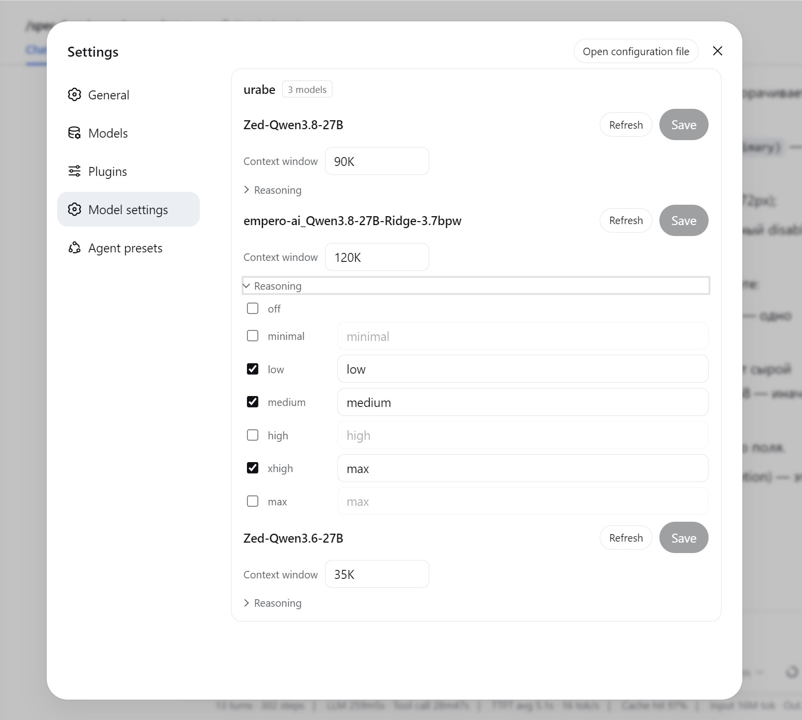

# @apkawa/dsh-model-settings

Per-model **reasoning effort** and **context window** management for llama.cpp models in dsh's settings.

## Screenshot

 

## Features

- **Model settings section** — a top-level settings page with a per-model accordion:
  - the seven thinking levels (`off`, `minimal`, `low`, `medium`, `high`, `xhigh`, `max`) as
    checkboxes with wire values;
  - a context-window field with a **Refresh** button that force-writes the size from the
    provider's live `/v1/models` listing (rounded down to the thousand);
  - one **Save** commits both parts together.
- Clearing: unchecking every stored level activates Save and, on save, clears the model's
  reasoning mapping (dsh's canonical `reasoningEfforts: false`); emptying the context-window
  field of a sized model drops the key so the model inherits again.
- **Context-window autofill** (host side): fills every unsized model's `contextWindow` from
  the provider's INI preset (`ctx-size`, else `fit-ctx`), rounded down to the thousand.

## How it works

- **Watcher** on `settings/updated` (host side, filtered to the `llm-pi-ai` section): for each
  candidate route one GET `<baseURL>/v1/models`, parse INI presets, fill every model that has no
  nonzero `contextWindow` yet.
- **Self-cycle guard**: a route whose models are all already sized is skipped entirely, so our
  own write never schedules another round.
- The section's rows and saves go over the plugin-owned `/model-settings` RPC channel (host
  handler on the same settings seam); failures surface as human-readable lines in the UI.

## Install

```
dsh plugin --profile web add github:apkawa/dsh-plugins#path:/packages/dsh-model-settings
```

## Debugging

Logs are quiet by default. Run dsh with `DEBUG=1` to see the plugin's trace output
(`fetchModels`, autofill rounds); error lines are always printed regardless of the flag.

## Development

See [AGENTS.md](../../AGENTS.md) for principles + pitfalls, and
[docs/ai/key-moments.md](../../docs/ai/key-moments.md) for architectural reference.
